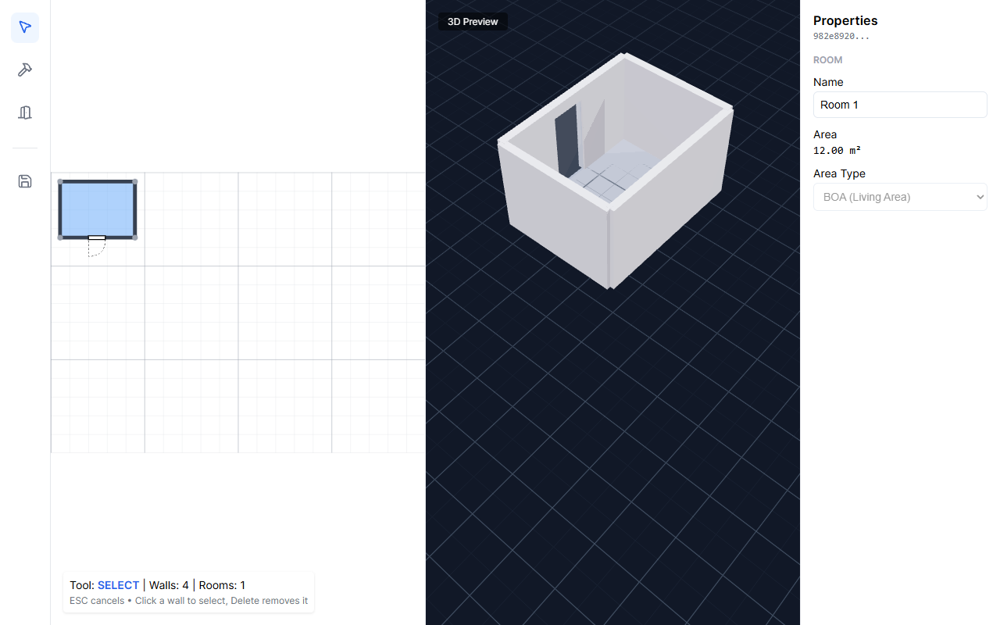

# 3D House Builder



A 2D floor-plan editor (SVG) with a live 3D preview (React Three Fiber). Draw walls in
plan view; rooms are detected from closed wall loops and extruded into 3D as you draw.

It is aimed at DIY home builders and renovators in Sweden. Producing building permit
(bygglov) documents from the plan is a goal, not a feature yet:
`src/core/domain/Bygglov.ts` holds types only, and the "Area Type (BOA/BIA)" select in
the property inspector is disabled.

## Quick start

```bash
npm install
npm run dev
```

Open http://localhost:5173. A project with a ground floor is created on load.

The 3D pane needs a browser with WebGL2. Without it the pane shows "3D preview is
unavailable" and the 2D editor keeps working. The app works fully offline: the
environment HDR is bundled under `public/hdr/` (CC0, see
[`public/hdr/README.md`](public/hdr/README.md)).

## Usage

Units are meters. The toolbar on the left has:

- **Select.** Click a wall or room to edit it in the inspector on the right: wall
  thickness, height, and material, or room name (area is shown read-only).
  Delete or Backspace removes the selected wall.
- **Wall.** Each click adds a wall and chains to the next point. Click the first node
  again (within 0.3 m) to close a room. Escape or right-click ends the chain.
- **Opening.** Hover within 0.5 m of a wall and click to place a 0.9 × 2.1 m door.
  Click beside the wall line, not on it; a click on the line selects the wall.
- **New Project.** Clears the plan and starts over.

## Scripts

| Script | What it does |
| --- | --- |
| `npm run dev` | Vite dev server with HMR |
| `npm run build` | Type-check (`tsc -b`) and production build |
| `npm run lint` | ESLint |
| `npm run preview` | Serve the production build |
| `npm test` | Run the Vitest suite once |
| `npm run test:watch` | Vitest in watch mode |
| `npm run test:coverage` | Tests with a v8 coverage report in `coverage/` |

CI runs lint, tests, and build on every push and pull request
(`.github/workflows/ci.yml`).

## Layout and contributing

`src/core` is framework-free geometry, domain, and state; `src/adapters/rendering` turns
the plan into Three.js meshes; `src/ui` is the React editor and viewport. Conventions,
architecture rules, and gotchas are in [`AGENTS.md`](AGENTS.md).

## Known gaps

- No save or load: the project is lost on page refresh.
- No undo or redo.
- Delete works for walls only. Rooms are derived from walls and cannot be deleted
  directly; nodes left behind by a deleted wall stay in the plan.
- Bygglov data (area types, permit fields) cannot be edited or exported yet.
- The 3D camera starts at a fixed position; walls drawn far from the plan origin
  (top-left corner) may need zooming out or orbiting to find.
